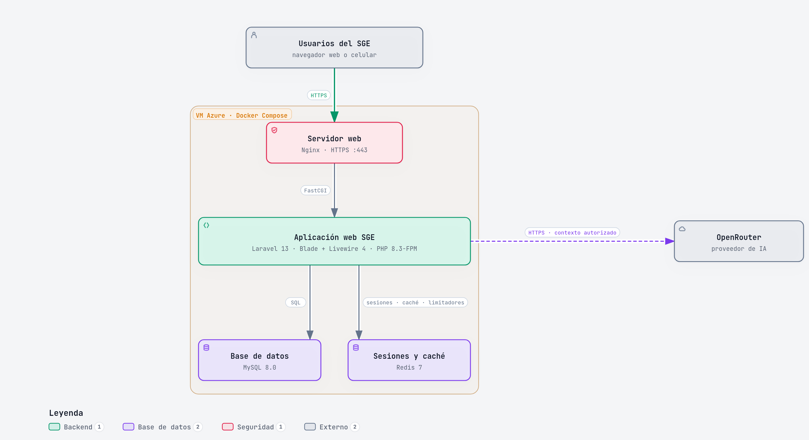

# Sistema de Gestión Escolar (SGE)

Aplicación web para gestionar una institución escolar: usuarios y permisos, estructura académica, matrícula, asistencia, notas con boleta en PDF y un asistente virtual.

[](https://github.com/JorgeBerroccal/Sistema-de-Gestion-Escolar/actions/workflows/ci.yml)
[](https://github.com/JorgeBerroccal/Sistema-de-Gestion-Escolar/releases)
[](https://sge-peru.chilecentral.cloudapp.azure.com)

**Curso:** Arquitectura de Software (IS-488)<br>
**Universidad:** Universidad Nacional de San Cristóbal de Huamanga<br>
**Escuela Profesional:** Ingeniería de Sistemas

## Módulos

| Módulo | Qué hace | Roles que lo usan | Detalle |
|---|---|---|---|
| 1. Autenticación y Roles | Inicio de sesión, usuarios, roles y permisos configurables | Todos inician sesión; administra el Administrador | [spec 001](specs/001-auth-roles-rbac/) |
| 2. Gestión Académica Base | Institución, años y periodos, grados, secciones, cursos y asignación docente | Administrador, Director (consulta), Docente (sus asignaciones) | [spec 003](specs/003-gestion-academica-base/) |
| 3. Matrícula | Alumnos, apoderados, matrículas y nóminas | Administrador, Director, Docente, Padre de Familia, Alumno | [spec 004](specs/004-matricula/) |
| 4. Asistencia | Registro diario por sección, consulta y reportes | Administrador, Director, Docente, Padre de Familia, Alumno | [spec 005](specs/005-asistencia/) |
| 5. Evaluación y Boletas | Notas por criterios, cierre de periodos, promedios y boleta en PDF | Administrador, Director, Docente, Padre de Familia, Alumno | [spec 006](specs/006-evaluacion-boletas/) · [evaluación](docs/evaluacion.md) |
| 6. Asistente Virtual | Chat en español sobre notas, asistencia y matrícula propias | Padre de Familia, Alumno | [spec 007](specs/007-asistente-virtual/) · [asistente](docs/asistente.md) |

Los roles indicados son los que traen los permisos por defecto ([`RolesYPermisosSeeder`](database/seeders/RolesYPermisosSeeder.php)); se pueden cambiar desde la interfaz. La infraestructura de despliegue e integración continua está en la [spec 002](specs/002-despliegue-ci-staging/).

## Arquitectura

PHP 8.3, Laravel 13, Livewire 4, Blade y Tailwind CSS; MySQL 8.0 y Redis 7; nginx + PHP-FPM con Docker Compose.



- **Monolito modular** en capas, con MVC y capa de servicios ([estilo](docs/02-arquitectura-software/estilo-arquitectonico.md), [patrón](docs/02-arquitectura-software/patron-arquitectonico.md), [contenedores C4](docs/04-modelo-c4/Nivel2-DiagramadeContenedores.md)).
- **Regla de autorización:** los permisos se verifican por identificador (p. ej. `usuarios.ver`), **nunca por nombre de rol**. Los roles son datos editables desde la interfaz; el código solo conoce permisos ([componentes](docs/02-arquitectura-software/componentes-arquitectonicos.md)).
- **Pertenencia *fail-closed*:** cada usuario ve solo lo que le corresponde y, ante la duda, se niega el acceso ([componentes C4](docs/04-modelo-c4/Nivel3-Diagrama-de-Componentes.md), ADR-011 en [decisiones](docs/01-analisis-de-sistema/07-decisiones-arquitectonicas.md)).
- **Proveedor de IA intercambiable:** el asistente usa un puerto con un adaptador falso para pruebas y otro para OpenRouter ([contexto C4](docs/04-modelo-c4/Nivel1-DiagramadeContextodelSistema.md), [asistente](docs/asistente.md)).

## Calidad y pruebas

| Qué | Resultado | Evidencia |
|---|---|---|
| Pruebas Pest (unitarias y de funcionalidad) | 951 pruebas en verde (20/11 en local y 23/11 en el CI) | [cobertura](docs/05-implementacion-y-validacion/cobertura/resumen.md) |
| Cobertura de líneas | 95,98 % de `app/` (CI, 23/11); 97,5 % en la capa de servicios (20/11) | [cobertura](docs/05-implementacion-y-validacion/cobertura/resumen.md) |
| Pruebas End to End | Cinco flujos con Pest Browser y Playwright; 8 pruebas en verde (local, 23/11) y job `e2e` en verde en el CI (24/11) | [pruebas End to End](docs/05-implementacion-y-validacion/pruebas-end-to-end.md) |
| Integración continua | Jobs `pruebas`, `e2e`, `cobertura`, `estilo` y `scripts` en cada push y pull request | [`ci.yml`](.github/workflows/ci.yml) |
| k6, 13/11: 1000 usuarios (más 20 docentes), 2 vCPU | **p95 no cumplido**; 0,00 % de solicitudes fallidas | [sesión del 13/11](specs/006-evaluacion-boletas/evidencias/k6-sesion-2026-11-13.md) |
| k6, 25/11: 2000 usuarios (más 20 docentes), 4 vCPU | **p95 no cumplido**; 0,00 % de solicitudes fallidas (0 de 49 367) | [sesión del 25/11](specs/006-evaluacion-boletas/evidencias/k6-sesion-2026-11-25.md) |

En ambas sesiones la CPU de la máquina llegó al 100 %. El criterio de carga del Módulo 1 (SC-006) está **no cumplido en p95**: estado real en su [especificación](specs/001-auth-roles-rbac/spec.md).

## Implementación y validación (Sprint 2)

- [Implementación y validación](docs/05-implementacion-y-validacion/README.md): dónde está la evidencia de cada entregable y las adaptaciones (Jest → Pest, sin API REST, k6 con 2000 usuarios).
- [Criterios de evaluación](docs/06-criterios-de-evaluacion.md): estado real de los 16 criterios.

## Documentación

La documentación de arquitectura describe el sistema **tal como se construyó**; cada hecho cita su fuente en el repositorio.

| Carpeta | Contenido |
|---|---|
| [`docs/01-analisis-de-sistema/`](docs/01-analisis-de-sistema/) | Necesidad, actores, historias (HU), requisitos (RF), atributos de calidad (AC), restricciones (RC), drivers (DA), decisiones (ADR) y escenarios (EQ), cada uno con su estado real |
| [`docs/02-arquitectura-software/`](docs/02-arquitectura-software/) | [Arquitectura inicial](docs/02-arquitectura-software/arquitectura-inicial.md) (conservada) con sus cambios, estilo, patrón y componentes arquitectónicos |
| [`docs/03-diseno-de-software/diseno-interno/`](docs/03-diseno-de-software/diseno-interno/) | Diseño interno de módulos, patrones y principios de diseño |
| [`docs/04-modelo-c4/`](docs/04-modelo-c4/) | Modelo C4: [contexto](docs/04-modelo-c4/Nivel1-DiagramadeContextodelSistema.md), [contenedores](docs/04-modelo-c4/Nivel2-DiagramadeContenedores.md), [componentes](docs/04-modelo-c4/Nivel3-Diagrama-de-Componentes.md) y [código](docs/04-modelo-c4/Nivel4-DiagramadeCodigo.md) |
| [`docs/despliegue/`](docs/despliegue/README.md) | Despliegue, CI, certificado, respaldo, costo y prueba de carga |
| [`docs/asistente.md`](docs/asistente.md), [`docs/evaluacion.md`](docs/evaluacion.md) | Asistente virtual y evaluación (enlazados, no duplicados) |

Los diagramas se editan en `docs/img/fuentes/*.archify.json` y se regeneran con Archify; cada uno tiene su versión interactiva en `docs/img/fuentes/*.html`.

## Metodología: Spec-Driven Development con Spec Kit

Con [GitHub Spec Kit](https://github.com/github/spec-kit), primero se escribe la especificación y luego el plan, las tareas y el código.
Los artefactos de cada módulo están en [`specs/`](specs/) (`spec.md`, `plan.md`, `research.md`, `data-model.md`, `contracts/`, `quickstart.md`, `tasks.md`)
y los principios del proyecto en la [constitución](.specify/memory/constitution.md).

## Pendientes

Tareas abiertas de la [feature 002](specs/002-despliegue-ci-staging/tasks.md):

- **T083, revisión de costos:** la revisión del 15/11 no se hizo en su fecha (sus datos se consultaron después); falta la del 15/12 contra la estimación: confirmar que el proyectado al 31/12 no pasa del 80 % del crédito y decidir si se detiene la VM hasta la sustentación ([costo y tamaño](docs/despliegue/costo-y-tamano.md)).
- **T078, cargos tras las sesiones de carga:** confirmar en *Cost analysis* que no aparecen cargos nuevos de B2als_v2 tras volver al tamaño diario, ni de B4als_v2 tras la [sesión del 25/11](specs/006-evaluacion-boletas/evidencias/k6-sesion-2026-11-25.md).

## Ejecutar en local

<details>
<summary>Comandos de Docker</summary>

Requiere Docker con Docker Compose v2.

```bash
cp .env.example .env        # definir SGE_ADMIN_USERNAME, SGE_ADMIN_EMAIL y SGE_ADMIN_PASSWORD
docker compose up -d --build
docker compose exec app composer install
docker compose exec app php artisan key:generate
docker compose exec app php artisan migrate:fresh --seed
docker compose --profile dev run --rm node sh -c "npm install && npm run build"
```

Datos de ejemplo, pruebas y prueba de carga: [`docs/desarrollo-local.md`](docs/desarrollo-local.md).

</details>

## Autor

Jorge Luis Berrocal Yucra
