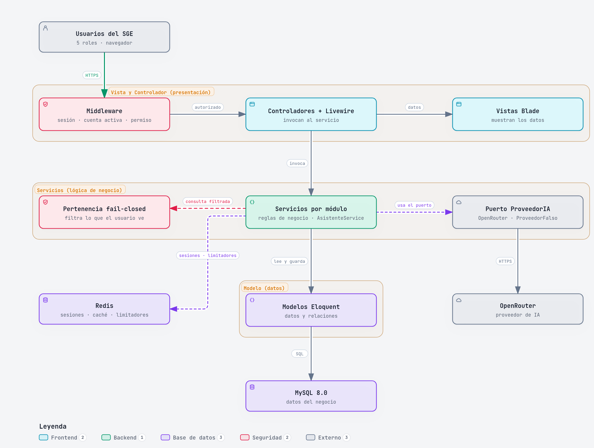

# Componentes arquitectónicos

Componentes del SGE organizados según el [patrón arquitectónico](patron-arquitectonico.md) **MVC con capa de servicios**, tal como se construyó. Las flechas indican **«invoca a»** o **«usa»**.

> Fuente editable: [`img/fuentes/componentes-arquitectonicos.archify.json`](../img/fuentes/componentes-arquitectonicos.archify.json) · versión interactiva: [`componentes-arquitectonicos.html`](../img/fuentes/componentes-arquitectonicos.html)

## Componentes y de dónde salen

| Parte del patrón | Componente | Responsabilidad | Origen | Código |
|------------------|------------|-----------------|--------|--------|
| Controlador | Middleware de sesión y cuenta activa | Exigir sesión (`auth`) y cuenta activa (`activo`); los componentes Livewire repiten la comprobación de cuenta activa. | RF01, spec 001 (FR-003, FR-004) | `app/Http/Middleware/EnsureUserIsActive.php`, `bootstrap/app.php`, `AppServiceProvider` |
| Controlador | Autorización por permiso | Resolver cada permiso contra `rol_permiso` (`Gate::before`) y proteger las rutas con `can:<permiso>`. | RF02, DA01, ADR-003 | `AppServiceProvider`, `routes/web.php`, `Usuario::tienePermiso()` |
| Controlador | Controladores HTTP | Login y cierre de sesión, guardado de notas, descarga de boleta y comprobación de salud `/up`. | RF01, RF15, RF17 | `app/Http/Controllers/` |
| Controlador | Componentes Livewire | Pantallas por módulo: listados, formularios, toma de asistencia, cierres de periodo, reportes y chat. | RC04 | `app/Livewire/<Módulo>/` |
| Vista | Vistas Blade | Mostrar la información de cada rol; el menú sale de `config/menu.php` según permisos. | RC01, RC04 | `resources/views/` |
| Servicio | Servicios de dominio | Aplicar las reglas: año vigente único, asignaciones, alta y matrícula de alumnos (individual y masiva), asistencia y justificación, criterios, notas, cierre de periodo y boleta. | RF05–RF18, DA04, DA07 | `app/Academico/`, `app/Matricula/`, `app/Asistencia/`, `app/Evaluacion/` |
| Servicio | Clase de cálculo y consultas | Promedio ponderado, anual y literal sin base de datos (`CalculoPromedios`); lecturas de notas y de resumen de asistencia reutilizadas por pantallas, boleta y asistente. | RF16, spec 006 (R-04) | `CalculoPromedios`, `ConsultaNotas`, `ResumenAsistencia` |
| Servicio | Pertenencia fail-closed | Restringir las consultas a lo que el usuario puede ver y denegar los modelos sin regla. | RF18, DA01, ADR-011 | `app/Autorizacion/Pertenencia/`, `config/pertenencia.php` |
| Servicio | Orquestación del asistente | Validar la pregunta, comprobar disponibilidad, elegir al alumno, aplicar el límite y armar el contexto. | RF19, RF20, DA02 | `app/Asistente/AsistenteService.php`, `ConstructorContexto`, `ResolverAlumno`, `LimiteSolicitudes`, `Disponibilidad` |
| Servicio | Puerto y adaptadores de IA | Implementar `ProveedorIA` con OpenRouter; sustituirlo por `ProveedorFalso` en pruebas y desarrollo. | RF19, ADR-004, RC07 | `app/Asistente/Proveedores/` |
| Servicio | Datos base | Sincronizar permisos, roles, escalas, tipos de documento y estados de asistencia en cada despliegue. | ADR-012 | `app/Console/Commands/SincronizarBase.php` |
| Modelo | Modelos Eloquent | Representar los datos y sus relaciones, acceder a MySQL y declarar la pertenencia (`RequierePertenencia`). | RC05 | `app/Models/` |
| Datos | MySQL 8 y Redis | Guardar los datos del negocio; sesiones y limitadores (intentos de login y solicitudes del asistente). | RC05, DA03, ADR-006 | `docker-compose*.yml`, `database/migrations/` |

**No existen** en el sistema construido y por eso no aparecen: trabajos y eventos (no hay cola, worker ni listeners), un componente de Auditoría, un módulo de Reportes aparte, un adaptador de la API de Claude y una caché de permisos.

## Lectura del diagrama

- **Flujo MVC:** el usuario pasa por el middleware (sesión, cuenta activa y permiso) → el controlador o componente Livewire invoca al servicio → el servicio aplica las reglas, usa los modelos Eloquent y recibe de la regla de pertenencia lo que el usuario puede ver → el controlador entrega los datos a la vista Blade.
- **Un solo patrón con matiz (ADR-002):** los módulos con reglas usan servicios; los catálogos simples de Gestión Académica se guardan desde el componente Livewire.
- **Servicios externos aislados:** el proveedor de IA se usa a través del puerto `ProveedorIA` y su adaptador, no directamente desde los servicios.
- **Boleta:** `BoletaController` autoriza y `BoletaService` arma los datos y genera el PDF con DomPDF en la misma solicitud.
- Cómo se ubican estos componentes en cada módulo y en ejecución se ve en el [modelo C4](../04-modelo-c4/).
