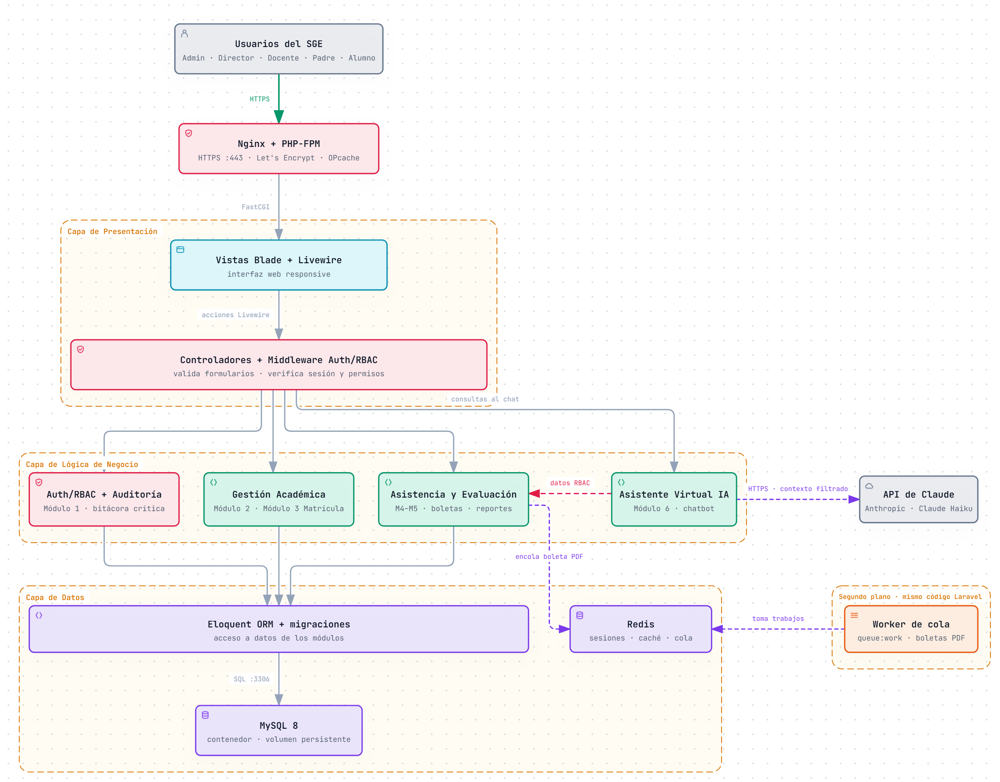
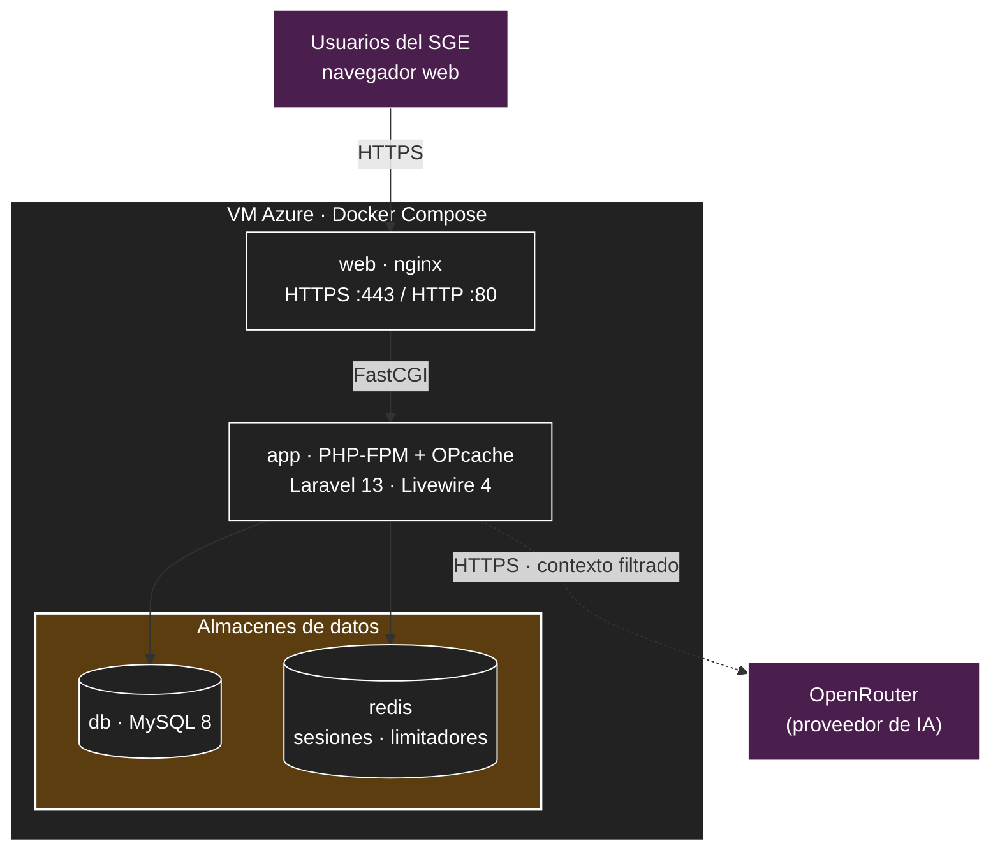

# Estilo arquitectónico

> **Pregunta guía:** ¿Cómo estructuramos globalmente el sistema?

El estilo arquitectónico es la **forma global de organización y despliegue** del sistema. No describe cómo se ordena el código por dentro; eso corresponde al [patrón arquitectónico](patron-arquitectonico.md). Este documento describe el estilo del sistema **tal como se construyó**; la propuesta original y sus diferencias están en [`arquitectura-inicial.md`](arquitectura-inicial.md#cambios-respecto-al-diseño-inicial).

## Estilo seleccionado

El SGE es un **monolito modular organizado en capas**. Cada término describe algo distinto:

| Término | Qué describe | En el SGE |
|---------|--------------|-----------|
| **Monolito** | Cómo se despliega | Una sola aplicación Laravel: una imagen `sge-app` (PHP-FPM) y una imagen `sge-web` (nginx con los archivos públicos) |
| **Modular** | División vertical por área de negocio | Gestión Académica, Matrícula, Asistencia, Evaluación, Asistente y Autorización, como carpetas de dominio en `app/` y de interfaz en `app/Livewire/` |
| **En capas** | División horizontal por responsabilidad técnica | Presentación → Lógica de negocio → Datos |

Cada módulo atraviesa las tres capas. Por ejemplo, cuando un docente guarda las notas de una sección: la ruta `POST /notas/registro/{seccion}/{curso}` y el middleware (`auth`, `activo`) y `NotasController` (presentación) → `EvaluacionService` valida permiso, año vigente, periodo y escala, y guarda todo o nada (negocio) → Eloquent escribe en MySQL (datos).

## Alternativas evaluadas

| Estilo | ¿Se adopta? | Motivo |
|--------|:-----------:|--------|
| **Monolito modular en capas** | **Sí** | Un solo despliegue, cabe en una VM pequeña y evita la complejidad de una red de servicios (DA05, DA06, DA09). |
| Microservicios | No | Varios despliegues, comunicación por red y monitoreo distribuido: no caben en dos meses (RC10) ni en una VM de 2 vCPU (RC09). |
| Cliente-servidor con SPA + API REST | No | La constitución (Principio I) prohíbe frameworks de frontend separados; Blade y Livewire van en el mismo proyecto (RC04). |
| Serverless | No | Laravel con sesiones y generación de PDF no encaja bien y el costo por uso es poco predecible (RC09). |
| Dirigido por eventos | **No** | El diseño inicial lo usaba de forma puntual (cola para boletas, eventos para auditoría). **No se construyó ninguna de las dos piezas** (ADR-007 y ADR-010 no implementadas): no hay colas, eventos ni listeners propios. |

La decisión está registrada en [ADR-001](../01-analisis-de-sistema/07-decisiones-arquitectonicas.md#adr-001--monolito-modular).

## Diagrama del estilo

Vista global del **diseño inicial** (con cola, worker y API de Claude). El diagrama del sistema construido es el de contenedores del [modelo C4](../04-modelo-c4/Nivel2-DiagramadeContenedores.md).

Versión interactiva: [`img/fuentes/sge-arquitectura-inicial.html`](../img/fuentes/sge-arquitectura-inicial.html).

### Vista de despliegue

Los cuatro contenedores del monolito en el servidor de staging. `web` y `app` usan imágenes distintas de la misma versión; MySQL y Redis no publican puertos.

Tamaños de la VM: `Standard_B2ats_v2` (2 vCPU, 1 GB) en el perfil diario y `Standard_B2als_v2` (2 vCPU, 4 GB) durante las sesiones de carga (ADR-009).

## Relación con los drivers

| Driver | Cómo lo atiende el estilo |
|--------|---------------------------|
| DA05 Laravel + Blade/Livewire | Una sola aplicación, sin frontend separado. |
| DA06 Docker de bajo costo | Cuatro contenedores en un solo servidor. |
| DA09 Mantenibilidad | Módulos con responsabilidades separadas por dominio; no se midió con `arch()` (AC05). |
| DA03 Rendimiento | El monolito evita llamadas de red entre módulos; Redis y PHP-FPM son parte del mismo despliegue. Con 2 vCPU el p95 de la carga no se cumplió (AC03). |

## Limitaciones aceptadas

- Todos los módulos escalan juntos: no se puede dar más recursos solo a Evaluación. La boleta PDF se genera en la solicitud y compite por la CPU con el resto (la carga la mostró como la operación más lenta).
- Un fallo grave de la aplicación afecta a todos los módulos, y no hay alta disponibilidad: una sola VM.
- Los límites entre módulos no los impone la red, sino la organización del código y las pruebas del [patrón arquitectónico](patron-arquitectonico.md).
