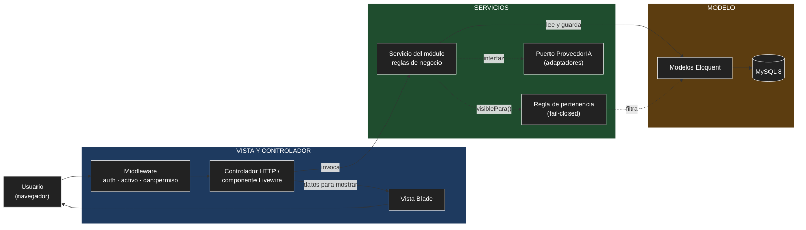

# Patrón arquitectónico

> **Pregunta guía:** ¿Qué estructura arquitectónica aplicamos?

El patrón arquitectónico define **cómo se organizan las responsabilidades y las dependencias internas** del sistema. El [estilo arquitectónico](estilo-arquitectonico.md) (monolito modular en capas) dice cómo se estructura y despliega el sistema; el patrón dice dónde vive cada responsabilidad dentro del código. Este documento describe lo **construido**; las diferencias con la propuesta inicial están en [`arquitectura-inicial.md`](arquitectura-inicial.md#cambios-respecto-al-diseño-inicial).

## Patrón seleccionado

| Elemento | Descripción aplicada al SGE |
|----------|-----------------------------|
| **Patrón arquitectónico** | **MVC (Modelo–Vista–Controlador) con capa de servicios**, organizado por dominio. |
| **Objetivo** | Separar los datos (modelo), la interfaz (vista) y la atención de las solicitudes (controlador), y concentrar las reglas de negocio en servicios. |
| **¿Qué problema resuelve?** | Evita que la lógica de negocio quede repartida en pantallas y controladores. |
| **Partes** | Modelo (Eloquent), Vista (Blade), Controlador (controladores HTTP y componentes Livewire) y Servicios. |
| **Matiz de lo construido** | Los módulos con reglas (Matrícula, Asistencia, Evaluación, asignaciones, años escolares, asistente) usan servicios. Los catálogos simples de Gestión Académica (niveles, grados, secciones, cursos, ficha de institución) los guardan los componentes Livewire con Eloquent, sin servicio. El plan de la spec 003 registra que el módulo se construye con «Eloquent + Livewire + dos clases de servicio con transacciones» (`AnioEscolarService` y `AsignacionService`); ninguna spec ni research explica por qué los catálogos simples quedan sin servicio, así que aquí solo se registra el hecho. |
| **Decisión registrada** | [ADR-002](../01-analisis-de-sistema/07-decisiones-arquitectonicas.md#adr-002--patrón-mvc-con-capa-de-servicios) (estado: modificada) |

## ¿Por qué MVC y no Clean Architecture?

Se evaluó Clean Architecture para todo el sistema y se descartó porque el SGE no la necesita:

| Criterio | Situación del SGE | Consecuencia |
|----------|-------------------|--------------|
| Tipo de sistema | La mayoría de los módulos registra, consulta y reporta datos académicos. | Las capas extra de Clean (entidades, puertos, traductores) agregan código sin beneficio. |
| Framework | Laravel está construido sobre MVC; Eloquent une el modelo con la tabla (Active Record). | Clean obligaría a traducir entre entidades y modelos Eloquent. |
| Servicios externos | Solo hay uno: el proveedor de IA (OpenRouter). | Basta una interfaz con adaptadores (`ProveedorIA`); no hace falta cambiar el patrón de todo el sistema. |
| Reglas de negocio | Escala y promedio, matrícula y traslados, asistencia, cierre de periodos y contexto del asistente. | Se concentran en servicios y clases puras y se prueban con Pest. |
| Simplicidad | La constitución (Principio VII) prefiere lo nativo de Laravel a capas y patrones adicionales. | Sin repositorios genéricos, CQRS ni colas. |

## Partes del patrón en el SGE

| Parte | Responsabilidad | En Laravel | Ejemplo en Evaluación |
|-------|-----------------|------------|-----------------------|
| **Modelo** | Representar los datos y sus relaciones; acceder a la base de datos; declarar la pertenencia. | Modelos Eloquent y migraciones | `Nota`, `CriterioEvaluacion`, `CierrePeriodo` (los dos primeros con `RequierePertenencia`) |
| **Vista** | Mostrar la información; sin reglas de negocio ni consultas. | Plantillas Blade | `resources/views/livewire/evaluacion/registro/`, `resources/views/boletas/boleta.blade.php` |
| **Controlador** | Recibir la solicitud, validar el formulario e invocar al servicio; autorizar. | Controladores HTTP y componentes Livewire | `NotasController`, `BoletaController`, `Livewire\Evaluacion\Registro\Show` |
| **Servicio** | Aplicar las reglas de negocio y coordinar los modelos. | Clases en la carpeta del dominio de `app/` | `EvaluacionService`, `BoletaService`, `ConsultaNotas` |
| **Clase de cálculo** | Reglas puras, sin base de datos. | Clase PHP sin dependencias de Eloquent | `CalculoPromedios` |

Complementan el patrón, sin cambiarlo:

- **Middleware y Gate:** `auth`, `activo` (`EnsureUserIsActive`) y `can:<permiso>` en las rutas; `Gate::before` resuelve el permiso contra `rol_permiso` (DA01). No hay clases Policy.
- **Pertenencia fail-closed:** `RequierePertenencia` en el modelo y una regla por modelo en `app/Autorizacion/Pertenencia/Reglas/`; un modelo sin regla se deniega (ADR-011).
- **Adaptador de IA:** la interfaz `ProveedorIA` aísla a OpenRouter; `ProveedorFalso` lo sustituye en las pruebas (DA02).
- **Comando de datos base:** `sge:sincronizar-base` mantiene permisos, roles y catálogos (ADR-012).

**No existen**, y por eso no forman parte del patrón construido: trabajos en cola (`Jobs`), eventos y listeners, ni un servicio de caché de permisos.

## Reglas del patrón

Las seis reglas de la propuesta inicial y su cumplimiento verificado en el código:

| # | Regla | Estado real | Cómo se verificó |
|---|-------|-------------|------------------|
| 1 | Los controladores y componentes Livewire no contienen reglas de negocio: validan el formulario e invocan a un servicio. | **Parcial.** Las operaciones con reglas llaman a servicios (p. ej. `NotasController` → `EvaluacionService::guardarNotas`). Los catálogos simples de Gestión Académica se guardan directamente en el componente (`Niveles\Index`, `Grados\Index`, `Secciones\Index`, `Cursos\Form`, `Institucion\Edit`). Fuente del hecho: `specs/003-gestion-academica-base/plan.md` (Constitution Check, Principio VII), que menciona solo dos clases de servicio. | Lectura de `app/Livewire/` y búsqueda de `::create(`, `->update(` y `->delete()`. |
| 2 | Las vistas no consultan la base de datos. | **Cumplida** en las plantillas Blade. **Los componentes Livewire sí consultan** con Eloquent (listados paginados con `with()`): 26 de los 34 componentes usan `::query()` o `DB::`. | Búsqueda de `::query` y `DB::` en `resources/views` (sin resultados) y en `app/Livewire` (26 archivos). |
| 3 | Las reglas de negocio viven en los servicios, no en los modelos ni en los controladores. | **En general cumplida**: las reglas citadas viven en servicios y clases puras; no se auditó cada componente uno por uno. | Lectura de `app/Evaluacion`, `app/Asistencia`, `app/Matricula`, `app/Academico`. |
| 4 | Un módulo usa a otro solo a través de sus servicios, nunca de sus tablas. | **Parcial.** El asistente y la boleta usan `ConsultaNotas` y `ResumenAsistencia`. Las reglas de pertenencia sí leen tablas de otros módulos con `EXISTS` (p. ej. `NotaRegla` sobre `criterios_evaluacion`, `cierres_periodo` y `asignaciones_docentes`). | Lectura de `app/Asistente/ConstructorContexto.php` y de `app/Autorizacion/Pertenencia/Reglas/`. |
| 5 | Toda llamada a un servicio externo pasa por una interfaz y su adaptador. | **Cumplida** para la IA (`ProveedorIA`). La librería DomPDF se usa directamente en `BoletaService`. | Lectura de `app/Asistente/Proveedores/` y `app/Evaluacion/BoletaService.php`. |
| 6 | Los permisos se verifican en middleware y policies, nunca dentro de la vista. | **Cumplida** con Gate y `can:` en rutas, comprobación en `mount()` y en servicios; **sin Policies**. El menú se declara por permiso en `config/menu.php`. | Lectura de `routes/web.php` y `config/menu.php`; prueba `SinCondicionalesDeRolTest`. |

Las reglas **no se verifican con pruebas de arquitectura de Pest (`arch()`)**: no existen en `tests/`. Se verifican con pruebas específicas (`SinCondicionalesDeRolTest`, `GenericidadTest`, pruebas de acceso por módulo).

## Diagrama del patrón

Flujo de una solicitud. Las flechas indican **«invoca a»**.



El diagrama de componentes completo está en [`componentes-arquitectonicos.md`](componentes-arquitectonicos.md).

## Relación con las tres capas del estilo

| Capa del estilo | Parte del patrón MVC |
|-----------------|----------------------|
| Presentación | Vista (Blade) y Controlador (controladores y Livewire), con el middleware y las rutas `can:` |
| Lógica de negocio | Servicios, clases de cálculo, reglas de pertenencia y el puerto de IA |
| Datos | Modelo (Eloquent) sobre MySQL, y Redis para sesiones y limitadores |

## Estructura de carpetas real

Los módulos son carpetas de dominio en `app/`; la capa web se organiza por módulo en `app/Livewire/` y `resources/views/livewire/`:

```
app/
├── Academico/                 AnioEscolarService, AsignacionService, ReglaAcademicaIncumplida, TipoPeriodo
├── Matricula/                 AlumnoService, MatriculaService, EstadoMatricula, Parentesco, Sexo, MatriculaIncumplida
├── Asistencia/                AsistenciaService, ResumenAsistencia, AsistenciaIncumplida
├── Evaluacion/                EvaluacionService, CalculoPromedios, ConsultaNotas, BoletaService, EvaluacionIncumplida
├── Asistente/                 AsistenteService, ConstructorContexto, ResolverAlumno, LimiteSolicitudes,
│   │                          Disponibilidad, Instrucciones, Resolucion, ResultadoAsistente
│   └── Proveedores/           ProveedorIA, ProveedorFalso, ProveedorOpenRouter, ProveedorNoDisponible, RespuestaIA
├── Autorizacion/
│   ├── ProteccionAdministracion.php
│   └── Pertenencia/           RequierePertenencia, ReglaPertenencia, RegistroReglasPertenencia,
│       │                      ReglaPertenenciaFaltante
│       └── Reglas/            AlumnoRegla, AsignacionDocenteRegla, MatriculaRegla, AsistenciaRegla,
│                              CriterioRegla, NotaRegla
├── Console/Commands/          SincronizarBase
├── Http/
│   ├── Controllers/           Auth/LoginController, NotasController, BoletaController, SaludController
│   ├── Middleware/            EnsureUserIsActive
│   └── Requests/Auth/         LoginRequest
├── Livewire/                  Academico/, Admin/, Asistencia/, Asistente/, Evaluacion/, Matricula/
├── Models/                    Usuario, Rol, Permiso, Institucion, Nivel, Grado, Seccion, Curso, AnioEscolar,
│                              PeriodoEvaluacion, EscalaCalificacion, AsignacionDocente, Alumno, Matricula,
│                              TipoDocumento, EstadoAsistencia, Asistencia, CriterioEvaluacion, Nota, CierrePeriodo
├── Providers/                 AppServiceProvider
└── Support/                   Formato, Sesion, ZonaHoraria
resources/views/               auth/, boletas/, errors/, layouts/, livewire/<módulo>/, inicio.blade.php
config/                        pertenencia.php, menu.php, asistente.php, asistencia.php, sge.php
database/                      migrations/ (23), seeders/ (datos base, demo y carga), factories/
tests/                         Unit/, Feature/, Load/ (carga.js, evaluacion.js)
```

## Ejemplo: guardar las notas de una sección

| Paso | Parte | Qué ocurre |
|------|-------|------------|
| 1 | Middleware | La ruta `POST /notas/registro/{seccion}/{curso}` exige sesión (`auth`) y cuenta activa (`activo`). |
| 2 | Controlador | `NotasController::guardar` pregunta a `EvaluacionService::puedeEscribir`: permiso `notas.gestionar`, o `notas.registrar_propia` más el marcador `docencia.dictar` y una asignación en la sección y el curso. Si no, responde 403 antes de tocar datos. |
| 3 | Controlador | Valida el formulario (`periodo`, `notas[alumno][criterio]`). |
| 4 | Servicio | `guardarNotas` exige año vigente, periodo del año y, para quien no gestiona, periodo abierto; obtiene los criterios del par (sección, curso, periodo) y la nómina activa. |
| 5 | Clase de cálculo | `CalculoPromedios::normalizar` valida cada valor contra la escala de la institución y deriva el valor numérico. |
| 6 | Servicio | Si alguna celda es inválida, no guarda nada y devuelve errores por fila y columna. Si no, una transacción hace `upsert` de las celdas llenas y borra las vacías, con `registrado_por`. |
| 7 | Controlador y vista | Redirige a la pantalla con el resultado. Los promedios no se guardan: `ConsultaNotas` los calcula al leer. |

## Ejemplo: consulta al asistente virtual

| Paso | Parte | Qué ocurre |
|------|-------|------------|
| 1 | Controlador | El componente `Livewire\Asistente\Chat\Index` comprueba `asistente.usar` y recibe la pregunta; los turnos viven solo en la pantalla. |
| 2 | Servicio | `AsistenteService::preguntar` valida el mensaje y consulta `Disponibilidad` (falla cerrado en producción si el adaptador no admite datos reales). |
| 3 | Servicio | `ResolverAlumno` elige al alumno entre los propios con `MatriculaRegla::alumnosPropios`; si hay varios hijos y el nombre no decide, responde con una aclaración sin llamar al proveedor. |
| 4 | Servicio | `LimiteSolicitudes` consume el cupo (por usuario y global). |
| 5 | Servicio | `ConstructorContexto` arma el texto con las consultas de las pantallas, para un solo alumno y sin documento, fecha de nacimiento ni correo. |
| 6 | Adaptador | `ProveedorIA::responder` envía los mensajes (`ProveedorOpenRouter` en staging, `ProveedorFalso` en pruebas). |
| 7 | Vista | Se muestra la respuesta con el aviso de que la genera una IA. |

## Costos aceptados

- La disciplina de «reglas en los servicios» no la impone Laravel y **no se verifica con `arch()`**; depende de las pruebas específicas y de la revisión.
- Los componentes Livewire de listados consultan con Eloquent, lo que acerca el controlador al modelo; se compensa con paginación, carga anticipada y los filtros de pertenencia.
- Las pruebas de los servicios usan una base MySQL de pruebas (`sge_testing`), porque los modelos acceden directamente a ella.
