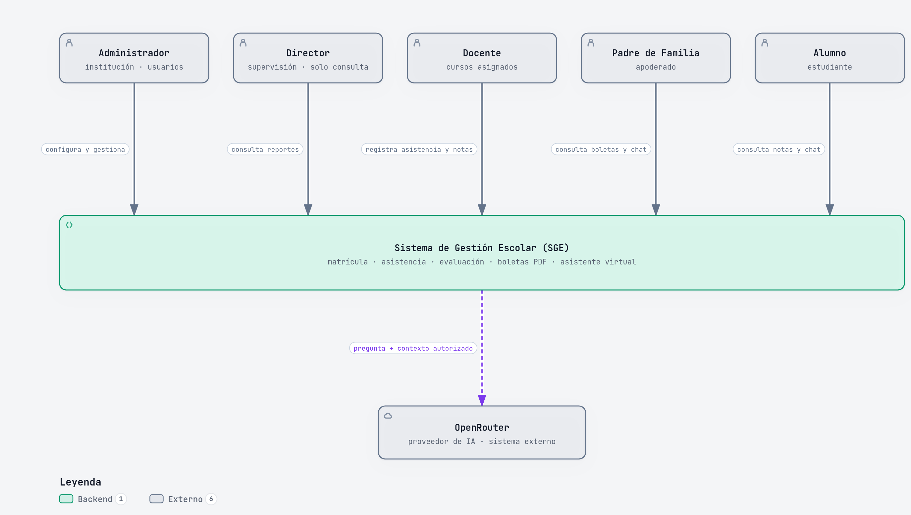

# Nivel 1 · Diagrama de contexto del sistema

> **Proyecto:** Sistema de Gestión Escolar (SGE) · **Modelo:** C4 · Nivel 1 de 4 · **Estado:** tal como se construyó (v0.7.0)

## 1. Objetivo

Mostrar el **SGE como una sola caja**: quiénes lo usan y con qué sistema externo se comunica.

| Aspecto | Descripción |
|---|---|
| Pregunta que responde | ¿Qué es el sistema, quién lo usa y con quién se integra? |
| Qué **no** muestra | Tecnologías, servidores, bases de datos ni módulos internos |
| Siguiente nivel | [`Nivel2-DiagramadeContenedores.md`](Nivel2-DiagramadeContenedores.md) |

## 2. Diagrama

> Fuente editable: [`img/fuentes/nivel1-contexto.archify.json`](../img/fuentes/nivel1-contexto.archify.json) · versión interactiva: [`nivel1-contexto.html`](../img/fuentes/nivel1-contexto.html)

## 3. Personas

Los cinco roles son datos (tabla `roles`); el código reconoce capacidades por permiso. Detalle en [01-actores](../01-analisis-de-sistema/01-actores.md).

| Persona | Qué hace en el sistema construido | Historias |
|---|---|---|
| **Administrador** | Configura institución, año escolar, estructura académica, usuarios, roles y permisos; matricula | HU02–HU08 |
| **Director** | Solo consulta (reportes de asistencia y notas) | HU10, HU17 (parcial) |
| **Docente** | Toma asistencia y registra notas de sus cursos y secciones asignados | HU09, HU11, HU12 |
| **Padre de Familia** | Consulta notas, asistencia y boleta de sus hijos; usa el asistente | HU13–HU16 |
| **Alumno** | Consulta sus notas publicadas, asistencia y boleta; usa el asistente | HU13–HU16 |

El estado real de cada historia está en [02-historias-del-usuario](../01-analisis-de-sistema/02-historias-del-usuario.md).

## 4. Sistemas

| Sistema | Tipo | Responsabilidad | Quién lo construye |
|---|---|---|---|
| **SGE** | Sistema en alcance | Matrícula, asistencia, evaluación, boletas PDF y asistente virtual de una institución | El proyecto |
| **OpenRouter** | Sistema externo | Proveedor de IA del asistente, detrás del puerto `ProveedorIA`; el modelo se define por entorno (`ASISTENTE_OPENROUTER_MODELO`) | Tercero |

## 5. Relaciones

| Origen | Destino | Descripción | Código |
|---|---|---|---|
| Administrador | SGE | Configura y gestiona | `app/Livewire/Admin/`, `app/Livewire/Academico/` |
| Director | SGE | Consulta reportes | `app/Livewire/*/Reportes/` |
| Docente | SGE | Registra asistencia y notas | `app/Livewire/Asistencia/Tomar`, `app/Livewire/Evaluacion/Registro/` |
| Padre de Familia | SGE | Consulta boletas y conversa con el asistente | `BoletaController`, `app/Livewire/Asistente/Chat` |
| Alumno | SGE | Consulta notas y conversa con el asistente | `app/Livewire/Evaluacion/Propia/`, `app/Livewire/Asistente/Chat` |
| SGE | OpenRouter | Envía la pregunta con el contexto autorizado para ese usuario | `app/Asistente/Proveedores/ProveedorOpenRouter.php` |

## 6. Decisiones y supuestos

| # | Decisión o supuesto | Origen |
|---|---|---|
| 1 | OpenRouter es el único sistema externo en ejecución; no hay pagos, correo ni integración con el Ministerio | RC17, ADR-004 (modificada) |
| 2 | En pruebas y desarrollo el proveedor es `ProveedorFalso` y no sale a la red | `config/asistente.php` |
| 3 | Una instalación atiende a una sola institución | RC13 |
| 4 | Los cinco roles usan la misma aplicación web responsive | RC01 |
