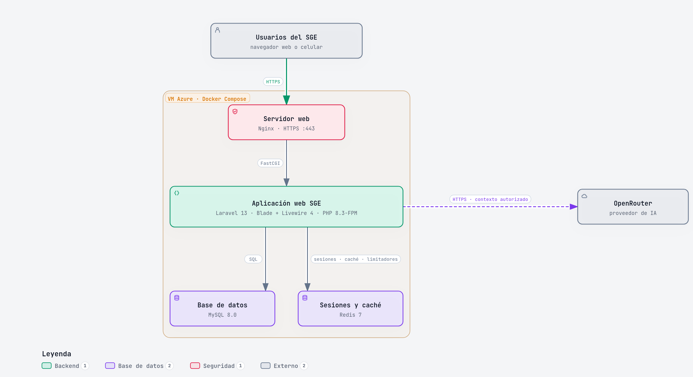

# Nivel 2 · Diagrama de contenedores

> **Proyecto:** Sistema de Gestión Escolar (SGE) · **Modelo:** C4 · Nivel 2 de 4 · **Estado:** tal como se construyó (v0.7.0)

## 1. Objetivo

Mostrar las **aplicaciones y almacenes** que forman el SGE en ejecución, sus tecnologías y cómo se comunican.

| Aspecto | Descripción |
|---|---|
| Pregunta que responde | ¿De qué piezas ejecutables se compone el sistema y qué tecnología usa cada una? |
| Nivel anterior / siguiente | [`Nivel1`](Nivel1-DiagramadeContextodelSistema.md) / [`Nivel3`](Nivel3-Diagrama-de-Componentes.md) |

## 2. Diagrama

> Fuente editable: [`img/fuentes/nivel2-contenedores.archify.json`](../img/fuentes/nivel2-contenedores.archify.json) · versión interactiva: [`nivel2-contenedores.html`](../img/fuentes/nivel2-contenedores.html)

## 3. Contenedores

Definidos en `docker-compose.prod.yml` (imágenes publicadas en GHCR: `sge-web` y `sge-app`) y, para desarrollo, `docker-compose.yml`.

| Contenedor | Tecnología | Responsabilidad | Código |
|---|---|---|---|
| **web** | Nginx; HTTPS en :443 con certificado Let's Encrypt (RC16) | Terminar HTTPS, servir estáticos y pasar PHP por FastCGI | `docker/nginx/` |
| **app** | Laravel 13, PHP 8.3-FPM, Blade + Livewire 4 | Toda la lógica: autenticación, módulos, boletas PDF (DomPDF) y asistente | `app/`, `docker/php/` |
| **db** | MySQL 8.0 | Datos del negocio; no se publica fuera de la red de Compose | `docker/mysql/` |
| **redis** | Redis 7 (`maxmemory` por perfil, `volatile-lru`, sin persistencia) | Sesiones, caché y limitadores de solicitudes | `docker-compose.prod.yml` |

**No existe** un contenedor *worker*: `QUEUE_CONNECTION=sync` y las boletas PDF se generan en la misma solicitud (ver [cambios respecto al diseño inicial](../02-arquitectura-software/arquitectura-inicial.md#cambios-respecto-al-diseño-inicial)).

## 4. Relaciones

| Origen | Destino | Protocolo |
|---|---|---|
| Usuarios (navegador) | web | HTTPS |
| web | app | FastCGI |
| app | db | SQL |
| app | redis | Sesiones, caché y limitadores |
| app | OpenRouter | HTTPS, solo el contexto autorizado |

## 5. Despliegue

Los contenedores corren en **una VM de Azure con Docker Compose** (staging); los perfiles de tamaño son `diario` (Standard_B2ats_v2) y `carga` (Standard_B2als_v2). El procedimiento está en [docs/despliegue](../despliegue/README.md) y el costo en [costo-y-tamano](../despliegue/costo-y-tamano.md); no se repite aquí.

## 6. Decisiones

| # | Decisión | Origen |
|---|---|---|
| 1 | Monolito: un solo contenedor de aplicación | ADR-001, RC09 |
| 2 | Sesiones y caché en Redis para soportar la carga | DA03, ADR-006 |
| 3 | Imágenes en GHCR y despliegue con `deploy/deploy.sh` | ADR nueva (GHCR + deploy.sh) |
