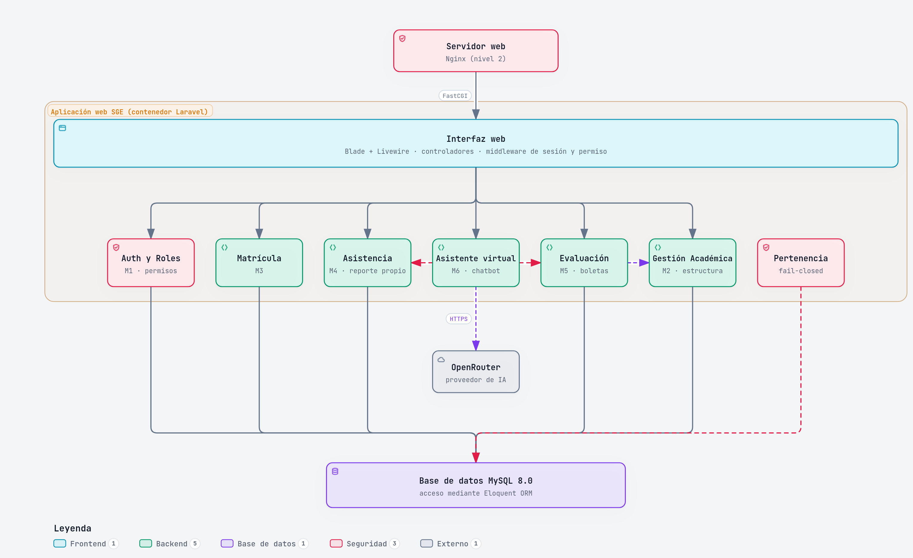

# Nivel 3 · Diagrama de componentes

> **Proyecto:** Sistema de Gestión Escolar (SGE) · **Modelo:** C4 · Nivel 3 de 4 · **Estado:** tal como se construyó (v0.7.0)

## 1. Objetivo

Descomponer el contenedor **app** en sus módulos y mostrar de quién depende cada uno. Los componentes arquitectónicos por capa del patrón MVC están en [componentes-arquitectonicos](../02-arquitectura-software/componentes-arquitectonicos.md).

## 2. Diagrama

> Fuente editable: [`img/fuentes/nivel3-componentes.archify.json`](../img/fuentes/nivel3-componentes.archify.json) · versión interactiva: [`nivel3-componentes.html`](../img/fuentes/nivel3-componentes.html)

## 3. Componentes

| Componente | Módulo | Responsabilidad | Código |
|---|---|---|---|
| **Interfaz web** | Transversal | Middleware, controladores, componentes Livewire y vistas Blade | `app/Http/`, `app/Livewire/`, `resources/views/` |
| **Auth y Roles** | M1 | Login, cuenta activa, usuarios, roles y permisos | `app/Http/Controllers/Auth/`, `app/Livewire/Admin/`, `app/Autorizacion/ProteccionAdministracion.php` |
| **Pertenencia** | Transversal | Reglas fail-closed que limitan cada consulta a lo que el usuario puede ver | `app/Autorizacion/Pertenencia/` |
| **Gestión Académica** | M2 | Institución, año vigente, niveles, grados, secciones, cursos y asignaciones | `app/Academico/`, `app/Livewire/Academico/` |
| **Matrícula** | M3 | Alumnos, apoderados, matrícula y nóminas | `app/Matricula/`, `app/Livewire/Matricula/` |
| **Asistencia** | M4 | Toma, justificación, resumen y reporte | `app/Asistencia/`, `app/Livewire/Asistencia/` |
| **Evaluación y Boletas** | M5 | Criterios, notas, promedios, cierre y boleta PDF | `app/Evaluacion/`, `app/Livewire/Evaluacion/` |
| **Asistente virtual** | M6 | Orquesta la pregunta y delega en el puerto `ProveedorIA` | `app/Asistente/`, `app/Livewire/Asistente/` |
| **MySQL 8** | Datos | Acceso mediante Eloquent | `app/Models/` |

**No existen** los componentes Auditoría ni Reportes aparte: los reportes viven dentro de cada módulo (`Asistencia/Reportes`, `Evaluacion/Reportes`) y de auditoría solo hay `registrado_por` y `cerrado_por` (RF22 parcial).

## 4. Dependencias

| Origen | Destino | Motivo |
|---|---|---|
| Interfaz web | Todos los módulos | Cada pantalla invoca al servicio de su módulo |
| Pertenencia | MySQL | Añade el filtro de pertenencia a las consultas de los modelos que usan `RequierePertenencia` (línea roja) |
| Evaluación | Gestión Académica | Año vigente, periodos y asignaciones (línea discontinua) |
| Asistente virtual | Evaluación (`ConsultaNotas`) y Asistencia (`ResumenAsistencia`) | Armar el contexto autorizado (líneas rojas) |
| Asistente | OpenRouter | Mediante `ProveedorIA` |
| Todos | MySQL | Eloquent |

## 5. Decisiones

| # | Decisión | Origen |
|---|---|---|
| 1 | Módulos como carpetas de dominio, sin paquetes separados | ADR-002 |
| 2 | El asistente solo conoce el puerto, no al proveedor | ADR-004 (modificada) |
| 3 | Pertenencia fail-closed: un modelo sin regla se deniega | ADR-011 |
