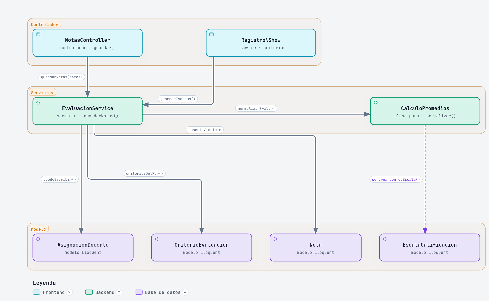
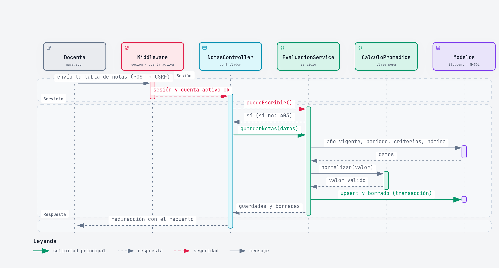

# Nivel 4 · Diagrama de código

> **Proyecto:** Sistema de Gestión Escolar (SGE) · **Módulo detallado:** Evaluación y Boletas · **Modelo:** C4 · Nivel 4 de 4 · **Estado:** tal como se construyó (v0.7.0)

## 1. Objetivo

Mostrar las clases del módulo Evaluación y cómo colaboran en el flujo **Registrar notas**. Se elige este módulo porque concentra las reglas de escala, promedio y cierre. Estructura de carpetas y reglas de dependencia: [diseño interno de módulos](../03-diseno-de-software/diseno-interno/diseno-interno-de-modulos.md).

## 2. Diagrama de clases

> Fuente editable: [`img/fuentes/nivel4-clases-evaluacion.archify.json`](../img/fuentes/nivel4-clases-evaluacion.archify.json) · versión interactiva: [`nivel4-clases-evaluacion.html`](../img/fuentes/nivel4-clases-evaluacion.html)

| Clase | Tipo | Parte | Responsabilidad |
|---|---|---|---|
| `Registro\Show` | Componente Livewire | Controlador | Pantalla de notas: periodo, editor de criterios y tabla |
| `NotasController` | Controlador HTTP | Controlador | Recibe el POST con CSRF de la tabla, comprueba `puedeEscribir` y llama al servicio |
| `EvaluacionService` | Servicio | Servicio | Permiso y asignación, año vigente, periodo abierto, transacción y `upsert` de notas |
| `CalculoPromedios` | Clase pura | Servicio | Normaliza el valor con la escala; promedios, etiqueta y aprobación |
| `EvaluacionIncumplida` | Excepción de dominio | Servicio | Mensajes sin datos personales |
| `EscalaCalificacion` | Modelo Eloquent | Modelo | Escala configurada (literal o numérica) que alimenta a `CalculoPromedios` |
| `CriterioEvaluacion`, `Nota`, `AsignacionDocente`, `PeriodoEvaluacion`, `CierrePeriodo` | Modelos Eloquent | Modelo | Datos del módulo; `Nota` y `CriterioEvaluacion` con pertenencia |

No hay interfaz `Escala` con estrategias ni eventos: la escala es **dato** (`EscalaCalificacion`) y una sola clase la interpreta.

## 3. Diagrama de secuencia: guardar notas

> Fuente editable: [`img/fuentes/nivel4-secuencia-registrar-nota.archify.json`](../img/fuentes/nivel4-secuencia-registrar-nota.archify.json) · versión interactiva: [`nivel4-secuencia-registrar-nota.html`](../img/fuentes/nivel4-secuencia-registrar-nota.html)

| Paso | Qué ocurre | Código |
|---|---|---|
| 1–2 | El middleware exige sesión y cuenta activa | `EnsureUserIsActive` |
| 3 | `NotasController::guardar` comprueba `puedeEscribir` (403 si no) y valida el formulario | `NotasController.php` |
| 4 | `guardarNotas` exige escritura: año vigente, periodo del año y periodo abierto | `EvaluacionService::exigirEscritura` |
| 5–6 | Cada celda se normaliza con la escala; un error cancela todo | `CalculoPromedios::normalizar` |
| 7 | En una transacción: `upsert` de las llenas y borrado de las vacías | `EvaluacionService::guardarNotas` |
| 8 | Redirección con el recuento de notas guardadas | `NotasController.php` |

Los promedios no se recalculan al guardar: se calculan al consultar (`ConsultaNotas`).
