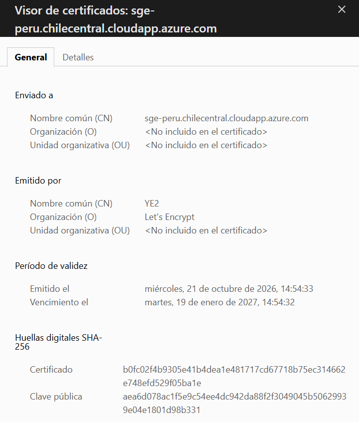

# HTTPS, red y memoria del servidor (T059, T060)

21/10/2026, hora de Lima (UTC−5). v0.2.0 desplegada en `sge-peru.chilecentral.cloudapp.azure.com` (B2ats_v2, `PERFIL_TAMANO=diario`).

## Verificaciones (T059)

| Verificación | Resultado |
|---|---|
| Inicio de sesión del Administrador | Correcto (ver `despliegue-y-vuelta-atras.md`) |
| `curl -s https://<fqdn>/up` | `{"status":"ok","version":"v0.2.0"}` |
| `http://` | `HTTP/1.1 301 Moved Permanently` (redirige a https) |
| Escaneo externo `nmap -Pn -p 22,80,443,3306,6379` (18:01) | 22, 80 y 443 **open**; 3306 y 6379 **filtered** (DC-002, FR-032) |
| `sudo certbot renew --dry-run` | «all simulated renewals succeeded» (renovación por webroot con la pila en marcha) |
| Permisos de `/opt/sge/.env` | `600 sge` |
| `exec app env \| grep -ci root` | 0 |

Nota: `sge` no tiene `sudo` sin contraseña; los comandos con `sudo` (como `certbot renew`) se ejecutan como `azureuser`.

| `opcache.validate_timestamps` (`php -r 'echo ini_get(...)'` en el contenedor `app`, CLI) | 0 |
| Candado en el navegador | Emitido por Let's Encrypt, válido hasta el 19/01/2027, sin advertencias:  (`https-candado.png`) |
| Búsqueda de secretos en el repositorio (FR-009) | Sin resultados, ver abajo |

### Búsqueda de secretos (21/10/2026)

Patrones: `APP_KEY` con `base64:` + 40 caracteres o más, claves privadas PEM, tokens `ghp_`/`github_pat_`, claves AWS `AKIA…`, tokens Slack `xox[bp]-`
y asignaciones `PASSWORD|SECRET|TOKEN|API_KEY=` con 16 o más caracteres.

- Árbol rastreado (`git grep -IE`, sin `vendor` ni *lockfiles*): **0 coincidencias**.
- Historial completo (68 *commits*, `git grep` sobre `git rev-list --all`): **0 coincidencias**.
- Ningún `.env`, `.pem` ni clave SSH fue añadido nunca al repositorio; `.env` está en `.gitignore`.
- Los secretos del servidor se generaron allí (`openssl rand`, `key:generate --show`) y nunca se vieron ni se pegaron fuera de él.

## Memoria en reposo con la pila corriendo (T060)

`free -m`:

| | total | usado | libre | caché | disponible |
|---|--:|--:|--:|--:|--:|
| Mem | 887 | 366 | 53 | 515 | 520 |
| Swap | 2047 | 232 | 1815 | | |

`docker stats --no-stream`:

| Contenedor | CPU | Memoria |
|---|--:|--:|
| sge-web-1 | 3,56 % | 14,8 MiB |
| sge-app-1 | 0,00 % | 40,4 MiB |
| sge-redis-1 | 0,35 % | 4,7 MiB |
| sge-db-1 | 0,32 % | 38,8 MiB |

Lectura: la pila cabe en 1 GB con el perfil `diario`; en reposo usa ≈ 366 MB, deja 520 MB disponibles y ≈ 232 MB en swap
(dato de referencia: parte del swap son páginas inactivas del sistema que `vm.swappiness=10` aún traslada). Los cuatro
contenedores suman ≈ 100 MiB. No hace falta ajustar `PERFIL_TAMANO=diario`.
