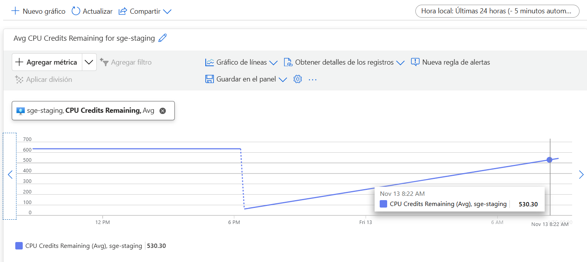
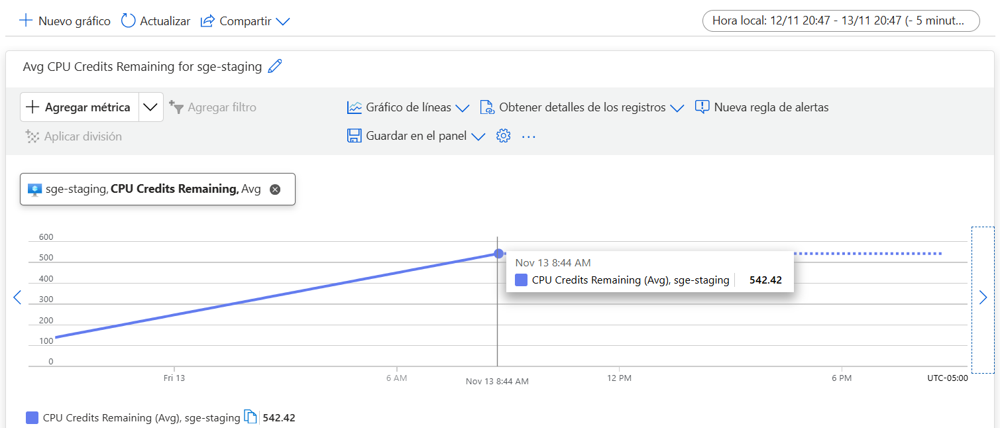

# Sesión de prueba de carga — 2026-11-13 (Módulo 5, T049)

Procedimiento: [`docs/despliegue/prueba-de-carga.md`](../../../docs/despliegue/prueba-de-carga.md).
**La sesión solo vale como evidencia si la casilla 16 está marcada y `cierre-carga.json` dice
`evidencia_completa: true`.**

- Versión desplegada: `v0.6.0` · Perfil: `carga` · Tamaño de la VM: `Standard_B2als_v2`
- Inicio en B2als_v2 (hora de facturación, UTC): `2026-11-12 23:24:47` · Arranque tras el Resize (`<desde-utc>`): `2026-11-12 23:24:47` · Inicio de la rampa (UTC): `2026-11-13T14:37:02Z` (workflow lanzado a las 14:37:18) · Fin (regreso a B2ats_v2): `…`
- Run ID de GitHub Actions (rampa completa, evaluacion.js): `43444464308` · Artefacto: `evidencia-carga-…`

## Preparación (12/11/2026)

**Paso 1 — cuota y crédito** (revisado el 12/11/2026 a las 10:00, más de 24 h antes de la sesión; el portal redondea las cifras):

| Dato | Valor | Criterio |
|---|---|---|
| Cuota BASv2 (Basv2 family vCPUs) | límite 10, uso 2, sin cambios | cabe B2als_v2 (2 vCPU) |
| Crédito disponible (página Education) | 92 USD de 100 | holgura ≥ 5 USD ✔ |
| Costos de noviembre | 2,94 USD | |
| Expiración del crédito | 16/10/2027 | |

**Paso 2 — respaldo manual** (como `sge` en el servidor, 12/11/2026 09:56:10): `2026-11-12 09:56:10 Respaldo creado: /var/backups/sge/sge-20261112-095609-manual.sql.gz (20K)`.

## Pasos 3 a 6 (noche del 12/11/2026, horas de Lima según el Registro de actividad)

| Paso | Resultado |
|---|---|
| 3. Deallocate | 12/11/2026 18:15:28 |
| 4. Resize a `Standard_B2als_v2` (Create or Update) | 18:20:45 |
| 5. Start | 18:24:47 (**23:24:47 UTC**, inicio de facturación en B2als_v2) |
| `az vm show` | `Standard_B2als_v2`, VM running |
| 6. `PERFIL_TAMANO=carga` + `deploy.sh --reconfigurar` | «Tamaño de la máquina: Standard_B2als_v2 · perfil: carga»; comprobación de salud correcta con `version=v0.6.0`; «Reconfigurado» en 17 s |
| `/up` | `{"status":"ok","version":"v0.6.0"}` |

## Créditos de partida (13/11/2026)

«CPU Credits Remaining» = **542,42** a las **08:44 de Lima (13:44 UTC)**, ≥ 200 (recomendado ≥ 400). Antes del
*Resize* la VM tenía unos 640 créditos en B2ats_v2; el *Resize* los reinició a unos 60 (como en T071a) y subieron
durante la noche.

| Captura | Contenido |
|---|---|
|  | Evolución de los créditos desde el resize |
|  | Valor de partida (542,42 a las 13:44 UTC) |

Pendiente (viernes 13/11): segunda rampa (`carga.js`, Módulo 1) y pasos 15 y 16.

## Lista de verificación

- [x] 1. Cuota BASv2 y holgura de crédito ≥ 5 USD
- [x] 2. Respaldo manual
- [x] 3. Stop (deallocated)
- [x] 4. Resize a B2als_v2
- [x] 5. Start
- [x] 6. `PERFIL_TAMANO=carga` + `deploy.sh --reconfigurar` + `/up` correcto
- [x] 7. `metrics.sh tamano` = `Standard_B2als_v2`
- [x] 8. `LoadTestSeeder` (1000 usuarios)
- [x] 9. Humo en verde (evaluacion.js: run 43443359763; carga.js: run 43443579090; ambos success sobre v0.6.0, 14:30 UTC aprox.)
- [x] 10. **Créditos de partida** ≥ 200 (valor: `542,42` a las `13:44` UTC; espera si hizo falta: ninguna). Se repite antes de cada nueva rampa
- [x] 11. `metrics.sh start` (14:37:02 UTC) + rampa completa de `evaluacion.js` (run 43444464308, 14:37:18 → 14:52:01 UTC): **umbrales de latencia incumplidos** (ver Resultados)
- [x] 12. `metrics.sh stop` (15:03:52 UTC; 217 muestras) + evidencias descargadas (`evaluacion-*`)
- [x] 13. `creditos-cpu.sh` ejecutado con inicio de rampa = arranque del workflow (14:37:18Z) (`evaluacion-creditos-*`)
- [x] 14. Evidencia de la primera rampa copiada al repositorio con el prefijo `evaluacion-` y resumida abajo (la segunda llevará `carga-`)
- [ ] 15. `PERFIL_TAMANO=diario` + `deploy.sh --reconfigurar`
- [ ] 16. **Regreso a B2ats_v2** + `metrics.sh cierre` → `evidencia_completa: true`

## Resultados de la rampa 1: `evaluacion.js` (umbrales del contrato del Módulo 5)

Run 43444464308 · 14,5 min · hasta 1020 VUs (1000 familias + 20 docentes) · k6 terminó con código 99 (umbrales cruzados).

| Métrica | Umbral (rampa) | p95 medido | Mediana | ¿Cumple? |
|---|---|---|---|---|
| Login (`login`) | < 3,5 s | 15,34 s | 1,08 s | No |
| Consulta de notas (`consulta`) | < 2 s | 13,89 s | 6,55 s | No |
| Registro de notas (`notas`) | < 4 s | 14,43 s | 0,68 s | No |
| Boleta PDF (`boleta`) | < 8 s | 16,40 s | 8,91 s | No |
| Solicitudes fallidas | < 1 % | 0,00 % (0 de 22 139) | | Sí |

Funcionalidad: 20 555 comprobaciones, 100 % correctas (1020 logins, 17 760 consultas, 241 guardados de notas, 516 boletas PDF válidas). Rendimiento global: 25,4 solicitudes/s; 19 517 iteraciones. Boletas PDF: 516 en 14,5 min (0,59/s de media).

## Recursos del servidor durante la rampa (de `evaluacion-metricas-20261113-0937.csv`)

| Métrica | p95 | Máximo |
|---|--:|--:|
| CPU del servidor (%) | 100,0 | 100,0 |
| Carga (load1, 2 vCPU) | 21,2 | 22,7 |
| Memoria usada (MB) | 1145 | 1169 |
| Swap usado (MB) | 0 | 0 |
| CPU / memoria `app` | 152,7 % / 136 MB | 192,7 % / 165 MB |
| CPU / memoria `db` | 58,6 % / 315 MB | 67,6 % / 315 MB |

La CPU llegó al 100 % hacia las 14:43 UTC (a los ~5-6 min, entre 300 y 600 VUs, ~25 solicitudes/s) y siguió saturada hasta el final de la rampa.
Modelo de CPU (`evaluacion-meta-servidor.json`): AMD EPYC 7763 · 2 vCPU · 3906 MB.

## Créditos de CPU (de `evaluacion-creditos-resumen.json`)

| Dato | Valor |
|---|---|
| Créditos al iniciar la rampa (14:37:18Z) | 572,22 |
| Créditos mínimos y hora | 559,82 (14:52:00Z) |
| ¿Se agotaron? | No |
| Minuto de la rampa en que la CPU quedó limitada | no aplica |
| Minutos con CPU limitada | 0 |

Los créditos casi no se movieron: la saturación es de capacidad (2 vCPU al 100 %), no de limitación por créditos.

## Observaciones

- ¿Servidor colgado? (hora, causa probable, qué se hizo)
- Análisis si no se cumplen los umbrales (cuello de botella, ajustes del perfil `carga`)
- Costo de la sesión (horas × 0,0526 USD): `…` (de `cierre-carga.json`: `…`)
